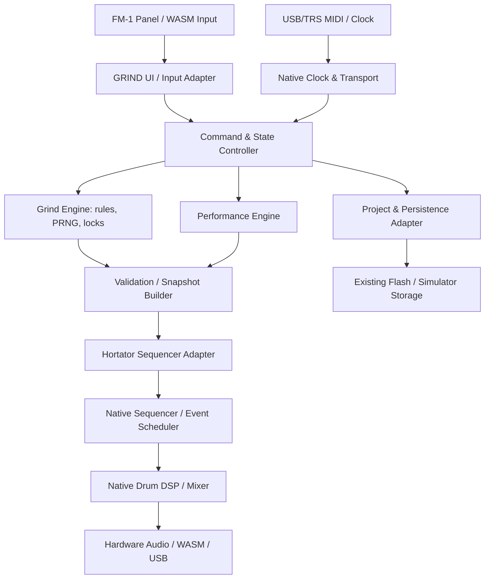

# GRIND MACHINE — FM-1 Edition

**Verbindliche Projektspezifikation / Product & Technical Design**\
**Version:** 1.1 (Community quality policy) · **Datum:** 27. November 2026\
**Status:** Produktumfang v1.0 genehmigt; Qualitäts- und Freigaberegeln auf beobachtete Community-Praxis angepasst.\
**Zielrepository:** `DaFum/grind-machine` (Hortator-Fork)\
**Upstream:** `DeadActive/hortator`, abgeleitet von `hugelton/Felucca`\
**Ziel:** M-VAVE FM-1, zunächst Standard-Build ohne Bluetooth\
**Lizenz:** Firmware-Code GPL-3.0-only; Assets und Fremdkomponenten gemäß Einzellizenzen.

---

## 0. Verbindlichkeit und Leseschlüssel

Diese Spezifikation beschreibt das Zielprodukt, Systemgrenzen und beobachtbares Verhalten, keinen Implementierungs- oder Gerätenachweis. Aktueller Build- und Teststatus steht in `docs/grind/baseline.md` und den jeweiligen PRs. Logische Modulnamen und Vorschläge werden gegen den tatsächlichen Code geprüft.

- **MUSS:** erforderlich für die beschriebene v1.0; Freigabe nur mit dokumentiertem Nachweis.
- **SOLL:** gewünschte Erweiterung, sofern Ressourcen und Stabilität es zulassen; eine Abweichung wird dokumentiert und genehmigt.
- **SPÄTER:** außerhalb von v1.0.
- **GATE:** die für den betroffenen Funktionsbereich tatsächlich anwendbare Prüfung aus bestehenden FM-1-Projekten; kein globaler Entwicklungsstopp wegen optionaler oder historisch nicht verfügbarer Messungen.

Musikalische Produktwerte bleiben unverändert. Qualitätsprüfungen folgen dem [Implementierungsplan v1.1](../plans/2026-11-27-grind-machine-implementation.md) und dessen Community quality policy. Diese ersetzt zusätzliche, selbst definierte Mindestwerte und Freigabepflichten aus v1.0.

## 1. Produktvision und Zielgruppen

GRIND MACHINE ist eine spezialisierte, eigenständige Drumcomputer-Firmware für Extreme Metal. Sie verbindet die Präzision eines Step-Sequencers mit der unmittelbaren Spielbarkeit eines improvisierenden Schlagzeugers. Der Benutzer wählt eine Rhythmusfamilie, steuert vier musikalisch verständliche Parameter und kann während des Spielens Fills, Blastbeats, Doublebass, Breakdowns und Variationen einsetzen. Er behält die Kontrolle über jedes erzeugte Pattern.

**Zielgruppen:** Gitarrist:innen beim Songwriting, Solo-Musiker:innen ohne Schlagzeuger, Grindcore- und Death-Metal-Bands, Live-Performer:innen und experimentelle Produzent:innen.

**Erfolgskriterium:** Nach dem Start kann eine Person ohne Computer oder DAW in wenigen Bedienhandlungen einen Blastbeat abspielen, ihn in einen Breakdown überführen, das Ergebnis manuell korrigieren und speichern. Die Bedienung bleibt auch bei hohem Tempo zuverlässig.

### 1.1 Produktprinzipien

1. Rhythmusregeln statt beliebiger Zufallstreffer; erkennbare Stilistik trotz Variation.
2. Echtzeitspielbarkeit und verlässliches Timing vor möglichst vielen Effekten.
3. Hardware-first: keine Abhängigkeit von Browser, Touchscreen, Netzwerk oder zusätzlichem Controller.
4. Kein Verlust manueller Änderungen durch die generative Engine.
5. Reproduzierbare Ergebnisse, klare Zustände, rückgängig machbare Mutation.
6. Konservative Firmware-Installation, nachgewiesene Wiederherstellbarkeit und offene Lizenzen.
7. Bestehende, stabile Upstream-Komponenten bevorzugt integrieren statt duplizieren.

### 1.2 Abgrenzung der Produktvarianten

| Entscheidung | Begründung |
|---|---|
| A – eigenständige GRIND MACHINE (gewählt) | Eigene UX, klare Positionierung, spezialisierte Engine und begrenzter Umfang. |
| B – zusätzlicher Hortator-Modus (nicht gewählt) | Weniger UI-Änderungen, aber weniger eindeutige Bedienführung und höherer Funktionsballast. |
| C – Synth-/Bass-/Drum-Groovebox (nicht gewählt) | Attraktiv, aber größeres Ressourcen- und Entwicklungsrisiko. |

GRIND MACHINE ist ein unabhängiger Fork, keine offizielle M-VAVE-, Felucca- oder Hortator-Ausgabe. Hardware und Loader werden nur bei nachgewiesener Notwendigkeit verändert.

## 2. Verifizierte Ausgangslage

Die öffentliche Hortator-Dokumentation wurde am 27.11.2026 geprüft [S1–S5]. Der Upstream beschreibt eine C-basierte Firmware für den FM-1 mit acht Spuren, individuellen Sequencer-Längen, Divisions und Swing, Synthese- und Sample-Modellen, Per-Step-Parametern, Effekten, USB-Audio, MIDI und WASM-Simulator. Er enthält bereits Projektvariationen und quantisierte Patternwechsel. Diese Angaben stammen aus der Dokumentation; Quellcode- und Build-Nachweise werden in der Foundation-Dokumentation fortgeführt.

| Upstream-Bestand | Umgang in GRIND MACHINE |
|---|---|
| `firmware/src/`, `firmware/hal/`, `firmware/loader/` | Native C-Integration; HAL und Loader standardmäßig unverändert. |
| 8 Tracks, 16 weiße Step-Tasten, bis zu 64 Steps/Track | Übernehmen; konsistente Metal-Kit-Belegung ergänzen. |
| Note, Accent, Probability, Ratchet, Nudge, Parameter-Locks | Weiterverwenden, soweit für die Grind Engine nötig und getestet. G-LOCK ist eine eigene Schutzsemantik. |
| Grids-Pattern-Engine | Nicht als zweite Grind Engine ausbauen; ARP-Sektion erhält die neue GRIND-Funktion. Bestehenden Code zunächst nicht unnötig löschen. |
| Mixer, Synthese, Samples, Filter, Distortion, Compressor, Limiter und Sends | Wiederverwenden; eigene Kit-Presets und konservative Gain-Struktur. |
| Fills, Cue, Variationen, Song, Projekt- und Preset-Funktionen | Bestehende Mechanismen nutzen; keine neue Song-Engine bauen. |
| 4 Flash-Projekte A–D, bis zu 8 Variationen je Projekt | Kapazitätsgrenzen und Konflikte mit Sample-/Lock-Bereichen beachten. Keine Garantie für 32 maximal dichte Patterns. |
| MIDI in USB/TRS, Clock in USB/TRS, Clock out USB, USB-Audio | Bestehende Funktionen regressionsprüfen; keine automatische Annahme, dass Sequencer-Hits als MIDI-Noten ausgegeben werden. |
| `web/`, Simulator, Installer, Editor | Eigenes Branding, gemeinsam genutzte Rhythmuslogik und kompatible Geräteidentität im Updateprotokoll. |
| `tests/`, `tools/`, Build-Skripte | Bestehende Tests erhalten; neue gezielte Host-, WASM- und Gerätetests. |

**Hardware-Korrektur:** Laut Upstream-Recovery-Dokumentation verwendet der FM-1 einen JieLi WL82 und den passenden proprietären pi32v2-Toolchain-Zweig. Es ist kein ESP32-Portierungsprojekt. Die vorhandene Hardware des Auftraggebers läuft mit Felucca; genaue Revision, JEDEC-Flash-ID und Felucca-Version sind noch nicht festgestellt [S3, S5].

**Bekannte Grenzen:** In Hortator werden Flash-Bereiche für Samples, Projekt-Locks und Variationen geteilt. Eine abweichende Firmware kann Daten anders interpretieren oder Teile überschreiben. Neuere FM-1-Einheiten können einen anderen Flash-Typ verwenden. Die verfügbare CPU-/RAM-/Flash-Reserve ist vor neuen Features zu messen. Der Bluetooth-Build hat geringere Ressourcenreserven und ist nicht das Ziel von v1.0 [S1, S3].

## 3. Umfang von v1.0

### 3.1 Muss-Umfang

| ID | Anforderung | Beobachtbares Ergebnis |
|---|---|---|
| FR-01 | Eigene Firmware, Bootscreen und Navigation | GRIND MACHINE identifizierbar; Gerät startet gestoppt in nutzbarem Zustand. |
| FR-02 | Acht Drumspuren | Alle Instrumentrollen lassen sich einzeln auslösen, editieren, muten und mischen. |
| FR-03 | 22 Rhythmusalgorithmen in sieben Kategorien | Jede Auswahl erzeugt ein charakteristisches, editierbares Pattern. |
| FR-04 | Vier Morph-Regler | Aggression, Density, Chaos, Humanize haben eindeutige, unterscheidbare Wirkungen. |
| FR-05 | Manueller Step-Sequencer | Bis zu 64 Steps/Spur, editierbar in 16er-Bänken; explizite G-LOCKs. |
| FR-06 | Deterministische Erzeugung | Gleicher Seed, Algorithmus, Parameterstand, Timing und Ausgangspattern liefern gleiche Events. |
| FR-07 | Sechs Live-Aktionen | BLAST, DOUBLE, FILL, BREAK, MUTATE, CHOKE; klare temporäre/permanente Semantik. |
| FR-08 | Vier Drumkits | Brutal Death, Raw Grind, Industrial Hell, Doom Abyss; gleichbleibende Rollenbelegung. |
| FR-09 | Projekte/Variationen | Vorhandene A–D-Struktur; Save/Load, Dirty-Status, sichere Kapazitätsprüfung. |
| FR-10 | MIDI und USB-Audio | Erhalt der dokumentierten kabelgebundenen Basiskompatibilität und Clock-Funktionen. |
| FR-11 | Rhythmische Vielfalt | Gerade und ungerade Taktarten, 1/8-, 1/16-, 1/32-Raster; Polymetrik mit definierter Wechselgrenze. |
| FR-12 | Simulator | Dieselbe Kernlogik, identische Seeds und Pattern-Ausgabe in WASM. |
| FR-13 | Schutz und Rückweg | Explizite, geprüfte Gerätefreigabe und dokumentiertes Backup/Recovery-Verfahren. |
| FR-14 | Distribution | Native Installationsdatei, Simulator, Quellcode, Lizenzübersicht, Handbuch, Prüfsummen und Release Notes. |
| FR-15 | Editierbare Werkspresets | Mindestens ein reproduzierbares Ausgangspreset je Rhythmusalgorithmus; ohne Verbrauch von Nutzerslots bis zur Übernahme. |
| FR-16 | Undo der letzten Mutation | Letzten nicht gespeicherten generativen Pattern-Wechsel verlustfrei rückgängig machen. |

### 3.2 Soll-Umfang (kein Stabilitätskompromiss)

- Mehrkanal-USB-Audio des Plain-Builds beibehalten; v1.0 muss mindestens die dokumentierte Stereo-Master-Funktion regressionsfrei erhalten. Eine Einschränkung der Mehrkanalfunktion gegenüber Upstream bedarf einer ausdrücklichen Freigabe.
- Optionales Senden generierter Drum-Noten über USB-MIDI (standardmäßig Kanal 10, konfigurierbar); nur mit eindeutig geprüfter Note-On/Off- und Clock-Semantik, ohne Echo-Schleifen.
- Erhalt des vorhandenen Web-Editors für kompatible Daten, Import/Export einer explizit versionierten GRIND-Projektdatei und Anzeige der Grind-Parameter. Vorhandene Backup-Funktion darf nicht stillschweigend brechen.
- Realistischere Sample-Variationen, Velocity-Layer oder Round-Robin nur bei gemessener Ressourcenreserve; synthetische oder kurze Layer sind gleichwertige Alternativen.

### 3.3 Nicht-Ziele

Keine vollständige DAW, keine neue Synthesizer-Workstation, keine Audio-Riff-Erkennung, keine KI-Cloud-Anbindung, keine automatische Gitarrenbegleitung, kein Bluetooth-/WLAN-Ausbau, keine neuen Flash-Partitionen ohne Audit, kein paralleler Felucca/Grind-Dualboot und keine native VIBE-FM-Portierung innerhalb v1.0. Vorhandene Upstream-Funktionen dürfen technisch erhalten bleiben, ohne Teil des primären GRIND-Workflows zu werden.

## 4. Benutzerabläufe

| Ablauf | Schritte | Erfolg |
|---|---|---|
| U-01 Schnellstart | Einschalten → GRIND → Algorithmus auswählen → PLAY | Default-Kit und ein hörbares, charakteristisches Pattern; Ziel: höchstens 4 explizite Bedienaktionen nach Boot. |
| U-02 Rhythmus formen | Während PLAY die vier Knobs drehen | Sofort sichtbarer Pending-Wert; musikalisch sauberer Wechsel an der nächsten zulässigen Grenze. |
| U-03 Manuell korrigieren | SEQ → Spur/BANK → Step ändern → G-LOCK prüfen | Änderung sichtbar; spätere Mutation erhält die geschützte Zelle einschließlich OFF-Zustand. |
| U-04 Live spielen | LIVE öffnen → BLAST/DOUBLE/FILL/BREAK/CHOKE halten → loslassen | Temporäre Performance ohne Änderung des gespeicherten Patterns. |
| U-05 Variation erzeugen | MUTATE auslösen → Änderung hören → optional UNDO | Reproduzierbare Variation; vorherige Version in RAM wiederherstellbar. |
| U-06 Kit wechseln | KIT → Kit wählen → bestätigen | Gleiche Instrumentrollen/Steps; Soundwechsel quantisiert oder im Stop-Zustand. |
| U-07 Projekt sichern | STOP → SAVE → Slot A–D → bestätigen | Speichervorgang bestätigt; Projekt nach Neustart wiederherstellbar. |
| U-08 DAW | USB anschließen → Clockquelle wählen → PLAY/Start | Stabile Sync, Audioaufnahme; Clock-Signalrichtung eindeutig. |
| U-09 Wiederherstellung | Vor Flash Backup und Hardwareprüfung → freigegebenes Paket installieren → bei Fehler dokumentierter Rückweg | Kein unkontrolliertes Schreiben; Nutzer weiß, wie Original- bzw. Felucca-Firmware wiederhergestellt werden kann. |

## 5. Musikalisches Datenmodell

### 5.1 Instrumentrollen (fest für Factory Kits)

| Track | Rolle | MIDI-Noten-Vorschlag (GM, falls Note-Out umgesetzt) | Klangaufgabe |
|---|---|---:|---|
| 1 | KICK | 36 | Einzelkick und alternierende Doublebass-Schläge auf derselben Spur. |
| 2 | SNARE | 38 | Backbeats, Blastbeats, Ghost Notes, Rolls. |
| 3 | HI-HAT | 42 / 46 | Geschlossene/offene Hats soweit Engine/Mapping zulassen; Choke-Gruppe. |
| 4 | RIDE | 51 | Führungsbecken für schnelle Patterns; Akzente. |
| 5 | CRASH | 49 | Phrasenbeginn und Übergänge. |
| 6 | CHINA | 52 | Aggressive Akzente, Breakdowns; optional eigenständiger synthetischer Klang. |
| 7 | HIGH TOM | 50 | Fills und technische Patterns. |
| 8 | LOW TOM | 45 | Fills, Doom und Breakdown. |

Die MIDI-Werte sind Mapping-Defaults für die neue Edition; ihre Konfliktfreiheit mit dem vorhandenen Parser und MIDI-Learn wird geprüft. Doublebass benötigt keine neunte Spur. Links/rechts alternierende Sample-Varianten sind eine mögliche Optimierung, nicht zwingend. Pro Spur dürfen schnelle Folgeschläge nicht durch das vorherige Decay unzulässig verschluckt werden; Stimme/Choke-Strategie folgt dem gemessenen Upstream-Audioverhalten.

### 5.2 Raster und Zeit

Intern repräsentiert die Grind Engine musikalische Zeit als ganzzahlige Positionen auf einem normierten Raster (Design: 96 logische Ticks pro Viertelnote). Der Adapter übersetzt in das tatsächliche Upstream-Timing; MIDI Clock bleibt standardkonform bei 24 Impulsen pro Viertelnote. Das interne Raster ändert weder die physische MIDI-Auflösung noch die Upstream-Clock. Native Step-Divisions werden bevorzugt; Ratchets nur, wenn sie der Engine für sichere schnelle Rolls zur Verfügung stehen.

- Tempo: Zielbedienbereich **40–350 BPM**. Effektiver Gerätebereich = Schnittmenge aus Zielbereich und nachgewiesenem stabilen Upstream-/Hardwarebereich. Außerhalb wird am Eingang begrenzt bzw. eine externe Clock als nicht unterstützt gemeldet; keine falsche Tempoanzeige. 350 BPM ist ein Validierungsziel, keine zugesicherte Hardwareleistung.
- Standard: 4/4, 1/16, ein Takt mit 16 Steps. Zweitaktige Patterns 32 Steps; bis zu 64 Steps je Spur, sofern Division und Taktzahl passen.
- Taktarten: 3/4, 4/4, 5/4, 6/8, 7/8, 9/8. Bei 1/16 ergeben sich pro Takt 12, 16, 20, 12, 14 bzw. 18 Steps. Bei nicht ganzzahliger Darstellung wird ein feineres Raster gewählt oder die Kombination abgelehnt. Keine stille Abschneidung.
- Gemeinsame Pattern-Wechselgrenze: das Ende des längsten aktiven Track-Zyklus, konsistent mit Hortator-Cue. Bei polymetrischen Spuren ist das **nicht** zwangsläufig das gemeinsame kgV aller Spurlängen. Zum Wechsel beginnen neue Spuren wieder bei Step 0. Bei gestoppter Wiedergabe sofortige Übernahme.
- Optionaler 1/32-Modus oder Ratchets für sehr schnelle Doublebass/Blastbeats. Beispielsweise 16tel bei 240 BPM = 16 Hits/s, 32tel = 32 Hits/s. Musikalische Machbarkeit und Audioqualität sind getrennt von der CPU-Machbarkeit zu prüfen.

### 5.3 Logische Zustände

| Entität | Felder / Invarianten |
|---|---|
| `GrindConfig` | Algorithmus-ID, Engine-Version, Seed (uint32), Mutationszähler, 4 Regler (0–100), Meter, Raster, Länge, Stil-/Fill-Optionen. IDs stabil und versioniert. |
| `PatternSnapshot` | 8 Tracks, je max. 64 Steps, Spurdivision, Länge, Event-/Accent-/Nudge-Information, native Step-Felder und G-LOCK-Maske. Alle Grenzen geprüft. |
| `StepCell` | ON/OFF, Akzent/Velocity nach Upstream-Möglichkeiten, Nudge, Ratchet, Probability, optional Note; OFF kann gesperrt sein. |
| `ProjectState` | Kit-/Mixer-/Effekteinstellungen, Upstream-Projekt und Variation, aktive GrindConfig und dazugehörige Lock-/Seed-Metadaten je gespeicherter Variation, Dirty-Status. |
| `PendingCommand` | Zielzustand bzw. vorbereiteter Snapshot, Zielgrenze, monotone Revision, Herkunft (UI/MIDI), validierte Referenz. Keine unbeschränkte Queue. |
| `PerformanceState` | gehaltene Live-Aktionen, aktive/ausstehende Overlays, Laufzeitgrenze, Transport-/Clock-Status. Nicht als Pattern speichern. |

Es handelt sich um logische Verträge. Binärformat, Größen, Ausrichtung und Schnittstellen werden anhand gepinnter Upstream-Strukturen bestimmt. Bei festen 512 Lock-Bits beträgt eine G-LOCK-Maske mindestens 64 Bytes pro vollständig editierbarer Variation; diese Größe ist bei der Flash-Kapazitätsprüfung zu berücksichtigen.

## 6. Grind Engine — Rhythmusfamilien

Notation für die Spezifikation: `K` Kick, `S` Snare, `H` Hi-Hat, `R` Ride, `C` Crash, `X` China, `T` Toms. Für 4/4 und 16tel sind Beats an Steps 0/4/8/12. Backbeats einer Standard-4/4-Figur liegen an 4/12. Die nachstehenden Regeln sind bewusst eigene, stiltypische Modelle und keine Kopien konkreter Songs. Die Engine darf sie über zulässige Divisionen und Metrumparameter adaptieren.

| ID | Kategorie / Algorithmus | Basisregeln, Akzente und Variation |
|---|---|---|
| ALG-01 | Blast / Traditional | K/S alternieren auf schnellem gleichmäßigem Raster; H oder R markiert die Kick-Positionen. Phrasenanfang betonen. |
| ALG-02 | Blast / Hammer | K und S auf denselben schnellen Positionen, H/R als Führungsbecken. Density steuert Zwischenpositionen, Kernakzente bleiben. |
| ALG-03 | Blast / Bomb | K kontinuierlich auf feinerer Division bzw. in Ratchets; S regelmäßig auf jeder zweiten Kick-Position oder gröberer Blast-Division, H/R stützt Puls. |
| ALG-04 | Blast / Gravity | S sehr schnelle Rolls mit abgestuften Akzenten, K und R deutlich langsamer als S. Simuliert das klangliche Resultat, nicht die physische Spieltechnik. |
| ALG-05 | Grind / Grind Blast | Traditional- oder Hammer-Kern mit kurzen Kick-Dopplungen, Beckenwechsel am Phrasenende, seltenen Mini-Fills. |
| ALG-06 | Grind / D-Beat | S-Backbeat; synkopierte K-Figur mit Vorwegnahmen, H/R konstante Achtel. Referenz K: 0/3/6/8/11/14, S: 4/12; Variation bleibt D-Beat-artig. |
| ALG-07 | Grind / Skank | Schneller, treibender Punk-/Thrash-Puls: K/S regelmäßig alternierende Achtelpositionen; durchgehendes Führungsbecken. |
| ALG-08 | Death / Doublebass | Gleichmäßiger Kick-Unterstrom auf 16teln/32teln, S auf Backbeats, H/R akzentuiert Viertel/Achtel; kurze Kick-Unterbrechungen bei niedriger Density. |
| ALG-09 | Death / Technical | Synkopierte Kick-Gruppen und verschobene Akzente in 3er-/5er-Gruppen, definierter S-Puls; gelegentliche T-Fills, ungerade Takte geeignet. |
| ALG-10 | Death / Brutal | Schwere K-Bursts, S-Stabs, China-Akzente; Wechsel von Doublebass-Teilen und halben Takten mit Slam-artiger Synkope. |
| ALG-11 | Powerviolence / Fast-Slow | Abwechselnd schnelle Blast-/Skank- und langsame Half-Time-Abschnitte, definierte Segmentgrenzen; Default 2 Takte. |
| ALG-12 | Powerviolence / Abrupt Break | Kurze schnelle Figuren, abrupt beendete Segmente und S/C-Akzent auf Wiedereinstieg. Geplante Stille ist Teil des Patterns. |
| ALG-13 | Powerviolence / Stop-and-Go | Akzentgruppen aus K/S/X mit klaren Pausen, anschließend kurze dichte Burst-Phasen. Pausen werden nicht durch automatische Density gefüllt. |
| ALG-14 | Hardcore / Breakdown | Half-Time-Snare, z. B. Step 8 in 4/4; synkopierte K-Schläge, punktuelle China-Akzente, freie Zwischenräume. |
| ALG-15 | Hardcore / Two-Step | K/S-Offbeat-Figuren und konstantes Achtelbecken; pulsierende, tanzbare Hardcore-Rhythmik. |
| ALG-16 | Hardcore / Half-Time | Reduzierte S-Pulse, K-Gruppen, Betonung von Phrasenanfang und halbem Takt; Variation erhält den Halftime-Eindruck. |
| ALG-17 | Experimental / Chaos | Kontrollierte Akzentverschiebung, Gruppen unterschiedlicher Länge, Ghost Notes und Stille; mindestens eine stabile Pulsreferenz, außer explizit programmierter Pause. |
| ALG-18 | Experimental / Industrial | Wiederholte maschinelle K/S-Figuren, gleichmäßige Velocity als Ausgangspunkt, metallische X/T-Akzente; Humanize standardmäßig 0. |
| ALG-19 | Experimental / Polymetric | Unterschiedliche Track-Zyklen innerhalb eines gemeinsamen Rasters, z. B. K 16, S 12, H 16, X 15; definierte Cue-Grenze am längsten Zyklus. |
| ALG-20 | Doom / Sludge | Langsame, ungleichmäßig akzentuierte K/S-Backbeats, sparsame Hats/Toms und lange Beckenakzente. |
| ALG-21 | Doom / Funeral | Sehr langsame, weit auseinander liegende K/S/T-Schläge, sparsame Becken; längere Pattern-Pausen. |
| ALG-22 | Doom / Stoner | Groove-orientierte K-Figuren, S-Backbeat, H/R in Achteln mit optionalem Swing und Ghost Notes. |

### 6.1 Regelhierarchie und Determinismus

1. Konfiguration, Spur-Raster, Länge und Algorithmus-ID validieren.
2. Algorithmus-spezifischen **Kern** (tragende Pulse/Akzente), Variation-Zonen und beabsichtigte Pausen bilden.
3. Density verändert optionale Schläge, Aggression die Dynamik und gegebenenfalls sicher gemappte Soundparameter; Chaos variiert nur zulässige Bereiche; Humanize setzt begrenzte Nudge-/Dynamikwerte.
4. Zufallsentscheidungen deterministisch aus stabil definiertem Integer-PRNG und domänenseparierten Schlüsseln (Seed, Algorithmus-ID, Track, Step, Mutation, Engine-Version) erzeugen. Kein Plattform-`rand()`, keine Uhrzeit, keine Floating-Point-Abhängigkeit für Evententscheidungen. Reihenfolge der Track-Auswertung darf das Ergebnis nicht verändern.
5. Manuell geschützte Zellen aus dem Ausgangspattern unverändert übernehmen (ON wie OFF; inklusive aller zugehörigen Step-Felder).
6. Ergebnis gegen Timing-, Stimmen-/Eventbudget, Step-Grenzen, Choke- und Datenregeln prüfen; bei ungültigem Ergebnis altes Pattern erhalten und Fehler anzeigen. Nicht stillschweigend geschützte Steps löschen.
7. Neuen Snapshot vorbereiten und an der Grenze atomar veröffentlichen. Keine halbfertigen Pattern-Updates im Audiopfad.

**MUSS:** Der gleiche vollständige Input erzeugt dieselbe kanonisch serialisierte Eventstruktur und Hash in Hosttests, WASM und Gerätetest. Dabei sind gespeicherte Locks und manuelle Ausgangsdaten ausdrücklich Teil des Inputs. Die Ausgabe des PRNG wird mit festen Testvektoren versioniert. Ein gespeicherter Snapshot bleibt auch nach einem Engine-Update abspielbar, selbst wenn zukünftige Neu-Generierung eine andere Engine-Version verwendet.

### 6.2 Morphing-Parameter

| Regler | Bereich / Default | Semantik und Grenzen |
|---|---|---|
| Aggression | 0–100 / 75 | Erhöht Akzentstärke und, soweit gemappt, kontrollierte Sättigung/Transienten; ändert nicht willkürlich ON/OFF. Optionaler Soundanteil mit Pegelbegrenzung; kein sprunghafter Master-Gain. |
| Density | 0–100 / 65 | 0 = notwendiger stiltypischer Kern (oder definierte Pause); 100 = maximal erlaubte optionale Hits innerhalb des Stil- und Ressourcenbudgets. Bei sonst gleichem Input werden optionale Hits über stabile Schwellen zugeschaltet, nicht neu gewürfelt. |
| Chaos | 0–100 / 20 | 0 = feste Basisstruktur; hohe Werte variieren optionale Hits, Akzentgruppen, begrenzte Verschiebungen. Stilanker und absichtliche Pausen bleiben erhalten. |
| Humanize | 0–100 / 25 | 0 = exaktes Grid ohne zusätzliches Timing-/Velocity-Jitter. Ziel bei 100: Timing-Offset bis zum kleineren Wert aus 6 ms und 1/8 eines Steps; Dynamikvariation bis ±12 % des Nennwerts, auf unterstützte native Auflösung quantisiert. Keine Überholungen, negativen Eventzeiten oder zusätzlichen Hits. |

Die Werte sind global für die aktive Variation; native Track-Parameter bleiben getrennt. Wenn Upstream nur Accent-Flags statt kontinuierlicher Step-Velocity anbietet, wird die dynamische Abbildung explizit quantisiert bzw. die Erweiterung in der Audiointegration nachgewiesen. Kein nicht unterstütztes Feld darf wirkungslos als volle Velocity-Funktion beworben werden.

Preset-spezifische Defaults sind erlaubt (z. B. Industrial Humanize 0), bleiben sichtbar und vom Benutzer änderbar. Knob-Bewegungen im Stop werden sofort angewendet; bei PLAY wird nur der jüngste gültige Zielzustand vorbereitet. UI zeigt sowohl Zielwert als auch Pending-Status. Potenziell unmittelbare Sound-Parameter werden nur bei vorhandener glitchfreier Smoothing-Funktion vor der Grenze aktualisiert; gespeicherte Morph-Werte gehören konsistent zum committed Pattern.

### 6.3 Manuelles Editieren, G-LOCK und Undo

- Jede manuelle Änderung einer Step-Zelle im GRIND-Workflow setzt standardmäßig den G-LOCK dieser Zelle. Beim Ändern eines bestehenden Locks bleibt er gesetzt. Ein explizites LOCK-Tool schaltet ihn einzeln um; UNLOCK ALL benötigt Bestätigung.
- G-LOCK schützt Rhythmusdaten; bestehende Upstream-Parameter-Locks sind Klangautomation und bleiben unverändert. Beide Funktionen erhalten getrennte UI-Symbole.
- Algorithmuswechsel, Morphing, MUTATE und Live-Rhythmus-Overlays verändern keine G-LOCK-Zelle. CHOKE und bewusst gesetztes Mute können ihre Audioausgabe unterdrücken, aber niemals ihre Pattern-Daten.
- Raster-/Längenwechsel, die geschützte Zellen außerhalb des neuen Bereichs bringen würden, werden mit `LOCK CONFLICT` abgelehnt. Nutzer muss gezielt entsperren oder eine neue freie Variation wählen. Keine automatische Trunkierung.
- UNDO speichert genau einen vollständigen vorherigen Snapshot und dessen Config (RAM). Es wird bei MUTATE bzw. expliziter Regeneration aktualisiert. Rücknahme erfolgt an derselben quantisierten Grenze, setzt keinen Flash-Schreibvorgang voraus und ist nach einem Neustart nicht garantiert. Eine spätere manuelle Änderung invalidiert den Undo-Snapshot (UI zeigt dies), damit Undo keine neueren manuellen Edits vernichtet.
- Bei unverändertem Ergebnis meldet MUTATE `NO CHANGE`, ohne Undo-Historie oder Seed unnötig zu überschreiben. Seed/Mutationszähler ändern sich nur mit einem erfolgreich veröffentlichten neuen Snapshot.

## 7. Live-Performance — LIVE ASSAULT

| ID | Aktion | Beginn / Ende | Wirkung |
|---|---|---|---|
| LIVE-01 | BLAST | Gehalten; ab nächstem Step, Rückkehr ab nächstem Step nach Loslassen | Temporärer Traditional/Hammer-Blast auf der aktiven Konfiguration, nicht gesperrte Steps. |
| LIVE-02 | DOUBLE | Gehalten; ab nächstem Step | Kick-Raster verdichten, im erlaubten Eventbudget; Loslassen stellt Basis-Kick wieder her. |
| LIVE-03 | FILL | Gehalten; quantisiert ab nächstem Step | Regelbasierter Fill im Phrasenendbereich; bevorzugt native FILL-Funktion. Loslassen beendet zukünftige Fill-Events. |
| LIVE-04 | BREAK | Gehalten; ab nächster Viertel-/Taktgrenze je Modus, Default nächster Takt | Half-Time-Breakdown; Rückkehr am nächsten Takt. Kein dauerhafter Tempo-Wechsel. |
| LIVE-05 | MUTATE | Einzeltrigger; nächste Pattern-Wechselgrenze | Erzeugt persistenten RAM-Pattern-Snapshot mit neuem Seed; undo-fähig, nicht automatisch gespeichert. |
| LIVE-06 | CHOKE | Sofortiger Trigger; solange gehalten Unterdrückung neuer ausgewählter Becken-Hits | Becken-Ausklänge schnell und klickarm beenden; gesperrte Daten bleiben erhalten. |

**Priorität (für gleichzeitige Aktionen):** CHOKE wirkt zuletzt auf die Ausgabe. BREAK hat Vorrang vor BLAST. FILL überlagert nur die Fill-Zone und respektiert die G-LOCKs. DOUBLE verändert die Kick-Zeile der gewählten Rhythmusgrundlage, außer ein BREAK-Algorithmus oder G-LOCK verbietet es. MUTATE verändert ausschließlich die darunterliegende Basis und niemals den Overlay-Zustand. Bei einem Clip/Projektwechsel werden temporäre Zustände zurückgesetzt. Nur eine laufende FILL-Instanz; wiederholtes MUTATE bis zur nächsten Grenze wird zu höchstens einer ausstehenden Mutation zusammengefasst.

STOP, externer Stop, Geräte-/UI-Moduswechsel aus LIVE sowie verlorene Key-up-Ereignisse beenden alle temporären Live-Aktionen deterministisch. Bei einem verpassten Release setzt ein begrenzter Watchdog die Aktion spätestens nach acht Taktzyklen zurück; ein noch physisch gehaltener, regelmäßig beobachteter Eingang verlängert die Aktion. Aktive Effekte sind im Display sichtbar. Für CHOKE ist der nachzuweisende Zielwert maximal ein Audio-Block bis zum Beginn des Fade-outs.

## 8. Benutzeroberfläche und Hardwarebedienung

### 8.1 Designsystem

Die Oberfläche nutzt das native FM-1-Display (Planungsraster 240 × 240; tatsächliche Rendermaße und Safe Areas am Upstream prüfen), vorhandene Knobs, Encoder, Tasten und Tastenbeleuchtung. Kein Touchscreen wird vorausgesetzt. Primär dunkler Grund mit kontrastreichen roten Akzenten, neutraler Textfarbe und amberfarbenem Pending-/Warnstatus. Farbe ist niemals der einzige Träger von Bedeutung: Text, Symbol oder Positionsmarker ergänzt jeden wichtigen Status. Kleine Bitmap-Schrift muss auf echter Hardware lesbar sein.

Header auf allen Hauptseiten: Projekt/Variation, PLAY/STOP, Clock/BPM, Dirty-Stern, Pending-/Fehlermeldung. UI-Screenwechsel darf Audio nicht unterbrechen. Werkspresets erhalten kurze englische Namen passend zur physischen Beschriftung; Handbuch kann deutsch/englisch erscheinen.

### 8.2 Seiten

| Seite | Zweck | Elemente |
|---|---|---|
| GRIND | Primäre Arbeitsansicht | Algorithmus, Meter, Pattern-Bank, 8×16-Step-Übersicht, Playhead, 4 Morph-Regler, Status. Default bei frischer Installation: ALG-03 Bomb, Brutal Death, 4/4, 1/16, Zieltempo 240 BPM innerhalb des validierten Bereichs. |
| STYLE | Algorithmus-/Meter-Auswahl | Kategorie, Algorithmusname, Meter, Division, Seed/Variation, Bestätigen/Abbrechen. |
| SEQ | Manuelles Editieren | 16 Steps der ausgewählten Spur, Bank 1–4, G-LOCK-Indikator, native Step-Felder. |
| KIT | Klangwahl | 4 Factory Kits, Rollenübersicht, sichere Preview/Bestätigung. |
| SOUND/MIX | Sound- und Mixerparameter | Native Modelle/FX, Level/Pan, Mute/Solo, Choke-Gruppe; keine doppelte Audioengine. |
| LIVE | Temporäre und dauerhafte Aktionen | 6 klar beschriftete Performance-Shortcuts, Status gehalten/pending, Rückkehr zu Basis. |
| PROJECT | A–D, Variationen und Backup | LOAD/SAVE/UNDO, Dirty-Warnung, Kapazität/Fehler, explizite Bestätigung. |
| GLOBAL | Tempo, Clock, MIDI, System | Native Setup-Funktionen; Hardware-/Build-Info und sicherer Updateeinstieg. |

Wenn acht Zeilen plus Regler auf dem echten Display nicht ausreichend lesbar sind, ist eine scrollbare bzw. seitenbasierte Track-Ansicht mit denselben Zuständen zulässig. Keine Verkleinerung bis zur Unlesbarkeit.

### 8.3 Vorgeschlagene Tastenbelegung

Die Namen orientieren sich am dokumentierten Upstream-Panel [S1]. Die endgültige physische Belegung muss im Simulator und auf dem Gerät geprüft werden, einschließlich Long-Press-Konflikten, LED-Verhalten, Key-Release und Safe-Start. Globale Transport- und Recovery-Tastenkombinationen haben Vorrang.

| Bedienelement | Normalfunktion in GRIND MACHINE |
|---|---|
| ARP (kurz) | GRIND/STYLE wechseln; ersetzt in der primären UX den Grids-Einstieg. |
| ARP (halten) | LIVE öffnen; die Seite bleibt nach Loslassen von ARP aktiv, bis eine andere Seite gewählt wird. Live-Aktionen richten sich nach ihren eigenen Tasten. |
| KNOB 1–4 in GRIND | Aggression / Density / Chaos / Humanize. In anderen Seiten zeigen Labels die dortigen Werte. |
| ALGORITHM | Wie Upstream: Spurwahl. Kein kontextloses Überschreiben der physischen Track-Wahl. |
| SELECT | Seitennavigation/Listen; in TRACKS weiterhin Tempo gemäß Upstream. |
| PRESETS | Im STYLE-Menü Rhythmusvorschau wählen; in SOUND bestehende Soundpreset-Wahl; Auswahl wird erst bestätigt. |
| HOME | GRIND als neue Standardansicht; weiterer HOME-Aufruf zur bestehenden Track-/Mixeransicht. HOME halten: Systemmenü. |
| SEQ | Step-Editor und native Tools; weißer Tastenblock = 16 Steps, OCT−/+ Bankwechsel. G-LOCK im expliziten LOCK-Tool. |
| EDIT | Native Soundbearbeitung; KIT-Auswahl über eigene Seite im EDIT-Bereich. |
| FX / FX halten | Native Effekte und Performance-Effekte bleiben erreichbar; keine Doppelbelegung mit GRIND-LIVE. |
| PLAY / REC | Bestehender Transport und Aufnahme; kein versteckter Start bei REC. |
| GLO / SAVE | Native System- und Projektfunktionen; HOLD-SAVE cue, sofern kompatibel mit Grind-Metadaten. |
| 6 schwarze Tasten auf LIVE | Von links beginnend sechs verfügbare schwarze Tasten für BLAST, DOUBLE, FILL, BREAK, MUTATE, CHOKE; im Simulator eindeutig beschriftet. |
| Weiße Tasten auf LIVE | Track-Trigger/Mutes nach explizitem, sichtbarem Modus; kein Step-Schreiben durch Performance-Key. |

Ein Key darf innerhalb einer Seite nicht gleichzeitig Step-Edit, MIDI-Note und Live-Aktion auslösen. Kontextwechsel während gehaltener Tasten muss die Aktion sauber abbrechen. Die dokumentierten Recovery-Kombinationen (insbesondere OCT− + OCT+ für Boot-Modus und SEQ beim Einschalten) werden nicht umgewidmet.

## 9. Sounddesign

### 9.1 Factory Kits

| Kit | Zielklang | Modell-/Preset-Richtung | Empfohlene Startparameter |
|---|---|---|---|
| BRUTAL DEATH | Präzise, modern, durchsetzungsfähig | Kurze Kick mit klaren Transienten, straffe Snare, kontrollierte Becken und tiefe Toms | Mittlere Kompression, geringe Room-Reverb, kurze Kicks; hoher Headroom. |
| RAW GRIND | Roher Underground-Proberaum | Akustische bzw. CC0-Samples, mildes Clipping im Track, trockene Hats | Wenig Reverb, körniger Track-Drive, hörbare Dynamik. |
| INDUSTRIAL HELL | Mechanisch, metallisch, hart | Native synthetische Kicks, Noise-Snare, metallische Cymbal-/Resonator-Modelle | Kontrollierte Distortion/SRR, Humanize im Style-Preset niedrig. |
| DOOM ABYSS | Tief, schwer, räumlich | Tiefe Kick/Toms, lange Decays, dunkle Becken, moderater Raum | Wenige Hits, langsame Ausklänge, kein übermäßiges Feedback. |

Alle Kits müssen vollständig ohne unlizenzierte Felucca-Assets gebaut werden können. Falls kein frei lizenzierbares China-Sample in angemessener Größe verfügbar ist, ist ein eigens erzeugtes, metallisch klingendes synthetisches Ersatzinstrument zulässig. Sample-Artefakte, Zuschnitt, Resampling und Peak-Werte werden dokumentiert.

### 9.2 Signalweg und Budget

Native Drum-Voice oder Sample → optionale native Layer/Choke-Gruppe → per-Track Gain/Filter/FX → Mixer → native Kompression/Limiter → Kopfhörer/Lautsprecher/USB-Audio. Keine zusätzliche parallele DSP-Engine. Factory-Presets verwenden konservative Gain-Werte und standardmäßig keine Ressourcen-intensiven Effektkombinationen. Soundwechsel bei PLAY wird an einer definierten Pattern-Grenze mit vorhandenen fades/smoothing oder nur im STOP-Modus freigegeben. Im Zweifel lieber `STOP TO LOAD KIT` als Audioartefakt.

Die v1.0-Kits müssen aus dem existierenden verifizierten Speicherbudget erzeugbar sein. Vier Kits sind vier Parameter-/Samplezuordnungs-Presets, nicht automatisch vier vollständige, separat gespeicherte Sample-Bibliotheken. Klangvielfalt kann durch vorhandene native Samples, CC0-Quellen und Synthesemodelle erreicht werden. Zusätzliche Velocity-Layer/Round-Robin werden erst nach einem Headroom-Test integriert.

### 9.3 Lizenz- und Asset-Politik

Hortator nennt GPL-3.0-only für Code und gesonderte Asset-Lizenzen. Aktuelles Felucca stellt den Hügelton Sample Pack (`tools/gen_waves.py` und erzeugte Sounds) unter CC0 1.0; die ältere Hortator-Kopie ist dadurch nicht ungeprüft freigegeben. Für jede tatsächlich verteilte Komponente gelten deren nachgewiesene Rechte [S2, S5].

MUSS: pro ausgeliefertem Asset Name, Pfad, Quelle, Urheber, Lizenz, Bearbeitung und Hash in einer maschinenlesbaren Inventarliste erfassen. Unklare Assets werden nicht ausgeliefert; durch eigene oder kompatibel lizenzierte Assets ersetzen. Originale Felucca-/Hortator-Urhebervermerke und Drittanbieter-Lizenzen erhalten. Binärdistribution mit vollständigem korrespondierendem Quellcode und Build-Anleitung gemäß GPL. Keine offiziellen Produktlogos oder irreführende Herstellerzuordnung. Keine Übernahme fremder Songaufnahmen, kommerzieller Drumkits oder Samples ohne entsprechende Rechte.

## 10. Architektur und Schnittstellen

### 10.1 Abhängigkeitsrichtung



Die neue Core-Engine ist portabel, hardwareunabhängig und frei von Dateizugriff, UI, USB, Flash und Audio-Callbacks. Der Controller besitzt den autoritativen Pattern-/Config-Zustand. Die Native Scheduler- und Audio-Schicht bleibt für exakte Sample-/Block-Zeitsteuerung zuständig. Browser und Gerät nutzen dieselben Core-Quellen; kein parallel neu implementierter JavaScript-Rhythmusgenerator.

### 10.2 Logische Module und Verträge

| Modul | Verantwortung / Vertrag | Nicht verantwortlich für |
|---|---|---|
| `grind_core` | Validierte Config + Ausgangspattern + Seed → deterministischer Basis-Snapshot oder typisierter Fehler. | Clock, GUI, Flash, Samples. |
| `grind_algorithms` | Stabile ID-Registry, Metadaten, stilistische Regeln, Referenzpresets. | Live-Transport, IO. |
| `grind_rng` | Integer-PRNG und Testvektoren; platformübergreifend reproduzierbar. | Speicher, globale System-Zufallsquelle. |
| `grind_locks` | Bitmaske, Copy-through geschützter Zellen, Konfliktprüfung bei Rasterwechsel. | Upstream-Sound-P-Locks. |
| `grind_perform` | Temporäre Overlays, Priorität, Release/Stop-Handling, Fill-Planung. | Permanente Speicherung von Overlay-Daten. |
| `grind_controller` | Input normalisieren, Config/Dirty/Undo, bounded Pending-Command, quantisierte Veröffentlichung. | DSP und Flash-Layout. |
| `grind_seq_adapter` | Konvertierung zum nativen Step-/Timingformat, Commit an nativer Cue-Grenze, Rückmeldung. | Duplizierter Sequencer. |
| `grind_kit_registry` | Vier Kitdefinitionen, Rollen-/Asset-Zuordnung, validierte Gain-Defaults. | Sample-Decoder. |
| `grind_persistence_adapter` | Versionierte Metadaten, Save/Load und Kapazitäts-/Kompatibilitätschecks im bestehenden Storagepfad. | Eigenmächtige Flash-Partitionierung. |
| `grind_ui` | Rendering, kontextsensitive Tasten, eindeutige Meldungen, Eingabe-Dispatch. | Direkte Pattern-Schreibzugriffe oder DSP-Parameter ohne Controller. |
| `grind_host_test` | Testbare Core-/Adapter-Schnittstellen, golden vectors, Regression- und Stress-Fixtures. | Produktionszustand. |

Die konkrete Abbildung auf Upstream-Dateien und APIs wird beim Foundation-Audit dokumentiert. Keine Implementierung soll auf erfundenen Upstream-Funktionsnamen basieren.

### 10.3 Echtzeit und Nebenläufigkeit

Pattern-Generierung, PRNG-Iteration, Kit-Auflösung, Serialisierung, Asset-/Flash-Zugriff und UI dürfen nie im zeitkritischen Audio-Callback erfolgen. Vorab reservierte Snapshots bzw. native sichere Update-Mechanismen verwenden. Ein Audio-Leser sieht stets die zuletzt vollständig veröffentlichte Revision. Alte Puffer werden erst wiederverwendet, wenn die Leserseite sie sicher freigegeben hat. ISR-/Thread-/Task-Modell anhand des Upstream bestimmen; keine Annahme, dass bestimmte C11-Atomics auf WL82 lock-free sind. Kritische Abschnitte kurz und messbar; weder lang laufende Sperren noch dynamische Speicherallokationen in neuen Echtzeitpfaden.

Der Controller arbeitet mit begrenzter Pending-Kapazität: ein aktueller Basiswechsel und begrenzter Overlay-Zustand. Mehrfaches Drehen überschreibt den noch nicht veröffentlichten Zielzustand. Ein stale Snapshot darf nicht nach einer neueren manuellen Edit-Revision veröffentlicht werden; bei Konflikt neu aus aktuellem Zustand erzeugen oder den Commit verwerfen und anzeigen. Eingabereihenfolge darf keine Datenrennen verursachen.

### 10.4 Fehlerbehandlung

| Fehler | Verhalten |
|---|---|
| Ungültige Config, Algorithmus-ID, Step-/Rasterlänge | Ablehnung, letzte gültige Konfiguration bleibt aktiv. `INVALID PATTERN` mit Kontext im Debug-Log. |
| G-LOCK-Konflikt | `LOCK CONFLICT`; keine automatische Datenvernichtung. |
| Snapshot über Ressourcen-/Eventbudget | `PATTERN LIMIT`; altes Pattern läuft weiter. Default-Presets bleiben innerhalb der validierten Grenzen. |
| Queue-/Commit-Konflikt | Neue Revision gewinnt, alte wird verworfen; UI zeigt Pending bzw. Fehler. Kein Teil-Commit. |
| Clock-Verlust | Keine automatische Quelle-Umschaltung. Externen Transport nach definierter Timeout-Erkennung sicher anhalten; `CLOCK LOST`. Fortsetzung erst nach gültigem Start oder bewusster Umschaltung. Timeout-Design: 500 ms oder drei erwartete Clock-Intervalle, je nachdem, welcher Wert größer ist; prüfen gegen native Clock-Behandlung. |
| Save nicht möglich, Kapazität zu klein | `NO SPACE`/`SAVE FAILED`; vorher gültige Datei nicht überschreiben, Dirty bleibt gesetzt. Kein verdecktes Löschen. |
| Beschädigtes/inkompatibles Projekt | Bestehenden Zustand behalten oder beim Boot sicheres Factory-Kit gestoppt laden. Warnung, keine automatischen Flash-Schreibvorgänge. |
| Fehlendes Sample/Kit | Validierter Ersatzklang oder sichtbarer Fehler; nicht ohne Warnung falschen Track auslösen. |
| USB getrennt / Browser geschlossen | Native Wiedergabe bleibt unabhängig, außer externe Clock geht verloren; Export/Restore sauber abbrechen. |
| Unbekannter Flash-Typ / ungültiges Paket | Installations- und Schreibfreigabe verweigern; dokumentierte Recovery-Information anzeigen. |

## 11. Projekte, Speicherung und Kompatibilität

### 11.1 Projektverhalten

Die vier bestehenden Projektplätze A–D bilden den v1.0-Storage-Rahmen. Bis zu acht Variationen pro Slot werden genutzt, solange das konkrete Speicherbudget reicht. Werkspresets werden als Regel-/Presetdefinitionen ausgeliefert und können bewusst in einen Nutzerplatz übernommen werden. Sie verbrauchen keine Nutzer-Flash-Slots ohne ausdrückliches SAVE.

MUSS je gespeicherter Variation: aktive Steps, Timing, stabile Algorithmus-ID, Seed/Engine-Version, Morph-Werte, G-LOCKs und zugehörige native Daten wiederherstellen. Kit, Mixer und die vom Upstream projektweit geteilten Parameter bleiben projektweit. Temporäre LIVE-Aktionen und Pending-Zustände werden nicht persistiert. Vor dem Speichern wird STOP verlangt, außer eine nachweislich audio-sichere native Speichermethode wird separat freigegeben. SAVE bestätigt erst nach erfolgreicher Verifikation der gespeicherten Daten. Stromverlusttests müssen zeigen, dass keine stillschweigend beschädigte Konfiguration als gültig geladen wird. Erhalt der letzten gültigen Version ist Ziel; falls Upstream dies nicht garantiert, benötigt v1.0 einen kompatiblen, verifizierten atomaren Speicherweg oder wird nicht für Hardware freigegeben.

### 11.2 Speicherstrategie und Versionierung

- Foundation ermittelt App-/Loader-/Data-Grenzen, Sektor-/Alignment-Größe, Record-Versionen, CRC/Integritätsmechanismen, verfügbare RAM- und Flash-Reserve je Variante und Auswirkungen auf USR-Samples, Lock-Bank, Variations-Bank und User-Presets.
- Neue Daten werden in einer explizit versionierten GRIND-Metadaten-Erweiterung gespeichert. Keine Verwendung vermeintlich freier Adressen oder stilles Überlagern vorhandener Felder. Erst Layout und maximale Record-Größe nachweisen. Falls notwendig wird die Anzahl gleichzeitig speicherbarer dichter Variationen nachvollziehbar reduziert und dem Nutzer angezeigt; es dürfen nicht heimlich Samplebereiche verkleinert werden.
- Upstream-Felucca-Projektformate sind **nicht** als GRIND-Import garantiert. Hortator-Import ist SOLL: nur bekannte, getestete Versionen read-only einlesen, Rollen-/Klangzuordnung transparent bestätigen, neue Daten in einen GRIND-Zielslot schreiben. Native Felucca-Tools nicht auf GRIND-Samplebereiche loslassen.
- Export/Backup ist versioniert und umfasst Metadaten, Prüfsumme, Kit-/Asset-Referenzen. Eine Projektdatei darf keine willkürlichen Firmware-/Flash-Schreibbefehle enthalten. Parser prüft Länge, Version, IDs, Wertebereiche und Hash/CRC. Ungültige Imports scheitern vor jeder Zustandsänderung.
- Ein Firmware-Downgrade kann trotz erhaltenem Binärinhalt ältere Projektformate nicht lesen. Die Dokumentation muss dies erklären. Kein Anspruch auf gemeinsamen Felucca-/GRIND-Projektspeicher. Originalbackups nur mit passendem Gerät und geprüftem Verfahren wiederherstellen.

## 12. Plattform, MIDI und Build

### 12.1 Native Plattform

Ziel ist der in der Foundation gepinnte Hortator-Plain-Build für JieLi WL82. Native Clock, Audio-/USB-/TRS-HAL, Loader und Recovery-Verhalten bleiben unverändert, soweit das Branding und geprüfte Integration es erlauben. Keine ungeprüften Änderungen an USB-VID/PID, Update-SysEx, Paketidentität oder Flash-Schutz. Produktname darf sichtbar neu sein, ohne den Installer inkompatibel zu machen.

Kabelgebundene MIDI-Clock in (USB/TRS gemäß Upstream) und USB-Clock out regressionsprüfen. Externe Start-/Stop-Nachrichten müssen im Gerätetest und bei unregelmäßigem Timing sauber funktionieren. Bei interner Clock werden keine eingehenden Clock-Impulse als Tempo interpretiert. Wenn Note-Out implementiert wird, Send/Thru/Receive-Regeln und Note-Off bzw. All-Notes-Off explizit festlegen; bei STOP keine hängenden MIDI-Noten. USB-Audio-Master muss unabhängig von der UI stabil bleiben. Keine Netzwerkpflicht.

### 12.2 Build- und Lieferkette

Upstream nennt Linux-x86-64-JieLi-Toolchain (clang 4.0.1/pi32v2), AC79-SDK-Dateien für das Paket, Python-/Node-Werkzeuge, Hosttests und WASM-Simulator [S1, S4]. `BUILDING.md` enthält noch historische Felucca-Bezeichnungen; die exakten Ausgaben/Flags der gepinnten Version werden im Foundation-Schritt mit den Buildskripten abgeglichen. Kein Vertrauen in veraltete Pfadangaben ohne Probe-Build.

Erforderlich:
- Den verfügbaren, gebauten Hortator-Ausgangscommit `44c9ad4aa57bebf63f412bd552e57143c30b4065` dokumentieren; historische nicht verfügbare Frozen-Referenz nicht als globale Voraussetzung behandeln.
- Die vorhandene Linux-JieLi-Toolchain, AC79 SDK und WASM-Buildumgebung mit dokumentierten Versionen nutzen. Bestehende Hash-Nachweise erhalten; keine neue Zertifizierung der Buildwerkzeuge als Entwicklungssperre. Lizenzrechte für Verteilung beachten.
- Upstream-Build (`./build.sh`, dokumentierte Paketoption `DRUM_PACKAGE=1 ./build.sh`), Hosttests (`tests/run_tests.sh`, `tests/run_drum_tests.sh`) und `tools/build_sim.sh` reproduzierbar ausführen; exakte Befehle nach gepinntem Code bestätigen.
- CI trennt hostseitige Coretests, Simulator, native Builds und Paketvalidierung. Nicht verfügbare proprietäre Tools klar als blockiert ausweisen, keine grünen Fake-Ergebnisse.
- Release-Pakete mit Version, Quellen, SHA-256 und Herkunftsnachweis nach dem [fm1-build](https://github.com/zvenson/fm1-build)-Community-Prozess erstellen. Kein zusätzliches Zwei-Build-Identitäts-Gate.
- Keine Veröffentlichung, wenn nur WASM und nicht die native Firmware erfolgreich gebaut wurde. Simulator-only Preview eindeutig als solche kennzeichnen.

## 13. Nichtfunktionale Anforderungen und Qualitätsbudgets

| ID | Ziel / Pflicht | Mess- bzw. Akzeptanzkriterium |
|---|---|---|
| NFR-01 | Audio-Stabilität | Vorhandene Audio-, Soak- und Gerätefunktionstests; keine unerwarteten Underruns, Resets oder hörbaren Dropouts. Keine zusätzliche Mindestdauer. |
| NFR-02 | Echtzeitbudget | Bestehende native Target-Budget- und Audio-Regressionsprüfungen; optionale Host-Instruktionsmessung wie bei SLOOP DX. Keine eigene prozentuale Audio-Deadline-Grenze. |
| NFR-03 | Speicher | Tatsächliche native Linker-, App-, Flash- und Pool-Grenzen einschließlich bestehender Upstream-Schutzgrenzen. Bestehende Stack-Analyse nutzen, soweit verfügbar; keine zusätzliche pauschale RAM-/Flash-Reserve. |
| NFR-04 | Transport | Native Clock-/Sync-Regressionen und Gerätefunktionstest, keine unerwartet ausgelassenen oder duplizierten Hits oder Phasensprünge. |
| NFR-05 | Bedienung | Bestehende UI-/Input-Regressionen, sichtbares Pending-Feedback, STOP-Priorität und quantisierte Audio-Wechsel; keine zusätzliche Latenzgrenze. |
| NFR-06 | Determinismus | Bytegleiche kanonische Ergebnisse für die vorhandenen Golden-Vektoren in Host/WASM; native Adapter-Regressionen und Gerätefunktionstest. |
| NFR-07 | Persistenz | Save/Load-/Neustart-Regressionen, A/B- und unterbrochene Schreibvorgänge im Flashmodell sowie Funktionstest auf dem Gerät; keine verlorenen bestätigten Änderungen. Keine zusätzliche Mindestzahl von Zyklen. |
| NFR-08 | Sicherheit | Kein neuer Flash-Schreibpfad ohne Layout-Audit; kein Update für unbekannte Revision. Vollständige Backup-/Recovery-Dokumentation. |
| NFR-09 | Wartbarkeit | Logische Modulgrenzen, bounded Buffers, keine unkontrollierte globale Mutation, relevante Unit-/Adapter-/Regressionstests. |
| NFR-10 | Offline & Lizenz | Native Kernfunktionen offline; entsprechende Quellen, Urhebervermerke und nachgewiesene Rechte für tatsächlich verteilte Bestandteile. |

Praxisprofil: dichtes Pattern, mehrere Spuren, hohe unterstützte Tempi, FX, Knob-Bewegungen, LIVE-Wechsel, UI sowie USB-Audio/MIDI. Vorhandene native Testprofile nutzen und tatsächliche Ergebnisse dokumentieren; keine zusätzlichen quantitativen Freigabegrenzen. Bekannte reproduzierbare Cue- oder Save-Fehler im betroffenen Pfad beheben.

## 14. Test- und Abnahmematrix

Neue Funktionen erhalten relevante reproduzierbare Regressionstests. Host/WASM prüfen Core und UI, native Tests die Integration. Hardwaretests prüfen Installation, Wiedergabe, Bedienung und Rückkehr zur bekannten Firmware. Die Produktfunktionen bleiben Abnahmekriterien; Tests werden nach betroffenem Funktionsbereich statt als zusätzliche universelle Zertifizierung eingesetzt.

| ID | Bezug | Abnahmetest (Given / When / Then) | Ebene |
|---|---|---|---|
| AT-01 | FR-01, FR-02 | Frischer Start → GRIND und PLAY → 8 Track-Rollen verfügbar, Boot beginnt gestoppt, ausgewählter Track korrekt. | WASM + Gerät |
| AT-02 | FR-03, FR-15 | Jede der 22 IDs mit Defaultconfig erzeugen → erwartete Kernpositionen, erlaubte Pausen, Trackgrenzen und eindeutige Stilmerkmale prüfen. | Host |
| AT-03 | FR-03, FR-06 | Wiederholte gleiche Inputdaten in Host/WASM → gleiche kanonische Event-Hashes, feste PRNG-Testvektoren; native Integration und Wiedergabe prüfen. | Host/WASM + Gerätefunktionstest |
| AT-04 | FR-04 | Parameter-Min/Max, Mittelpunkte und feste Seeds → Density optional monoton, Aggression keine zufällige ON/OFF-Änderung, Chaos begrenzt, Humanize 0 ohne Jitter. | Host + Audio |
| AT-05 | FR-05 | ON- und OFF-Zellen samt Native-Step-Feldern sperren → Morph/Style/MUTATE/LIVE → geschützte Daten unverändert; G-LOCK und P-LOCK getrennt. | Host + WASM |
| AT-06 | FR-05, FR-11 | Alle sechs Meter und drei Raster validieren → korrekte Länge oder explizite Ablehnung; Rasteränderung mit Lock-Konflikt wird abgelehnt. | Host |
| AT-07 | FR-11 | Polymetrik 16/12/15 → Cue am Ende des längsten Zyklus; neue Spuren Step 0; keine kgV-Fehlinterpretation. | Adapter |
| AT-08 | FR-04, FR-06 | Schnelle Eingaben/Knob-Bewegungen und manuelle Edits → neueste Revision gewinnt, keine stale/teilweisen Commits, kein OOB. | Host + Stress |
| AT-09 | FR-07 | Alle LIVE-Aktionen einzeln und paarweise, Hold/Release, STOP, Seitenwechsel und fehlendes Release → richtige Priorität und keine dauerhaft hängenden Aktionen. | Host + WASM + Gerät |
| AT-10 | FR-07, FR-16 | MUTATE im PLAY → quantisierte Änderung, UNDO an Grenze → vorheriger Snapshot identisch; nach manueller Änderung kein destruktives Undo. | Host + WASM |
| AT-11 | FR-08 | Alle vier Kits laden und jede Spur spielen → richtige Rollen, keine fehlenden/unlizenzierten Assets, Pegel/Choke im sicheren Bereich. | Host + Audio + Gerät |
| AT-12 | FR-09 | Vier Slots, Variation bis Kapazitätsgrenze füllen → korrektes Save/Load, Dirty, Versionierung; Überlauf meldet Fehler, alte Daten bleiben erhalten. | Flashmodell + Gerät |
| AT-13 | FR-09, FR-13 | Beschädigte/alte/verkürzte Records, Schreibunterbrechungen und falscher Import → kein stiller Verlust, ungültige Daten abgelehnt, sichere Defaults. | Host-Flashmodell |
| AT-14 | FR-10 | USB/TRS-MIDI, interne/externe Clock, Start/Stop und Clock-Verlust → keine unerwünschte Auto-Umschaltung, dokumentierte Fehlermeldung. | Integration + Gerät |
| AT-15 | FR-10, NFR-01 | USB-Master-Audio und ggf. Mehrkanalmodus unter Worst-Case-Last → stabil, korrekte Kanalzuordnung und kein Underrun. | Gerät |
| AT-16 | FR-12 | Simulator bootet und spielt ohne native Hardware; gleiche Core-Version und Golden-Vektoren; Tastenkontexte und Fokusbedienung geprüft. | WASM |
| AT-17 | FR-13 | Unbekannte Flash-ID, Paket-/Hash-/Versionskonflikt, nicht freigegebene Revision → Installer verweigert Schreiben bzw. endet sicher. | Installer-Mock + Testgerät |
| AT-18 | FR-13 | Vorab gesichertes Testgerät → freigegebenes Paket installieren → validiertes offizielles/Felucca-Recovery und erneutes Starten; Datenintegrität gemäß dokumentiertem Rückweg. | Gerät, kontrolliert |
| AT-19 | FR-14 | Sauberer Checkout → gepinnter Build, native/WASM-Artefakte, Prüfsummen, vollständige Quellen, Lizenzinventar und Handbuch. | CI + Releaseaudit |
| AT-20 | NFR-01–05 | Vorhandene Audio-/Target-/Speicher-/UI-Regressionen und Hardware-Praxisprofil → stabiler Betrieb innerhalb der tatsächlichen nativen Grenzen. | Host + Gerät |
| AT-21 | NFR-07 | Persistenz-Zyklen, Stromausfall-Injektion im Modell → kein unerkannt defekter bestätigter Save; letzte gültige Version nachweisbar. | Host + Gerät |
| AT-22 | FR-05, NFR-09 | Fuzzing/Property-Tests auf Algo-/Meter-/Seed-/Lock-/Step-Eingaben, inklusive 0/Max/-1/Überlauf/ungültigen IDs → keine OOB-Zugriffe, undefinierte Arithmetik oder ungültige Events. | Host (Sanitizer, sofern verfügbar) |
| AT-23 | FR-10, SOLL Note-Out | Falls Note-Out vorhanden: schneller Lauf, STOP und Thru → korrekte Note-On/Off-Paare, keine hängenden Noten oder Echo-Schleifen. | MIDI-Integration + Gerät |
| AT-24 | FR-01, FR-07, NFR-05 | Hardware-Panel: alle Tasten, Short-/Long-Press, Wechsel, Recovery-Kombinationen, 64-Step-Bänke; keine Doppelaktion und lesbare Statusanzeige. | Gerät |

**Testdaten:** Pro Algorithmus mindestens ein Golden-Pattern, weitere Seeds und Randbedingungen. Zusätzlich die kombinatorisch riskanten Fälle: hohe Density + Chaos, gesperrte OFF-Zelle bei Doublebass, knapper Variationsspeicher, externes Clock-Stop bei pending MUTATE, Kit-Wechsel bei ausklingenden Becken und stale Snapshot nach manuellem Edit. Ein Golden-Update ist nur mit dokumentierter beabsichtigter Verhaltensänderung erlaubt; es darf einen Fehler nicht lediglich neu als Baseline definieren.

## 15. Hardwarefreigabe und sicherer Installationsprozess

**Kein Flashen allein auf Basis dieser Spezifikation.** Die aktuelle Felucca-Installation des Auftraggebers bleibt bis zum freigegebenen Testpaket unverändert. Ein Browser-Simulator ist kein Nachweis für korrekte Flash- oder Audio-Hardwarefunktion.

### 15.1 GATE-HW-0 — Gerätekompatibilität und Rückweg

Vor dem ersten GRIND-Flash:
1. Exakte FM-1-Hardware-/Flash-ID und bestehende Firmwareversion über ein dokumentiertes, ausschließlich lesendes Verfahren feststellen. Neue Flash-Chips separat behandeln. Felucca dokumentiert z. B. eine Beta-Unterstützung für UC25HQ80 (`0xB36014`), deren damalige reale Validierung offen war [S5]. Daraus folgt keine automatische Hortator-/GRIND-Freigabe.
2. Kompatibilitätsmatrix mit genauem Gerät, Flash-Typ, gepinntem Upstream-Stand, Loader-/Installer-Version und unterstütztem Paket erstellen.
3. Nutzerprojekte/Presets/Samples mit passendem Felucca-Werkzeug sichern und den dokumentierten Rückweg bereithalten. Vollständiger Flash-Readback ist keine zusätzliche Pflicht.
4. Original-Firmware und bekannte funktionierende Felucca-Version, Quellen/Installer und Wiederherstellungsanleitung bereithalten; Stromversorgung und bekannt gutes Datenkabel prüfen. Kein zweiter Installer/Editor gleichzeitig.
5. Verifizieren, dass das konkrete Rückkehrverfahren zum Gerät und Betriebssystem passt. Upstream dokumentiert Boot-ROM-Recovery auf einem Mac für bestimmte Fälle; wenn das Gerät Boot-Modus nicht erreicht, kann zusätzliche Transporter-Hardware nötig sein [S3]. Es besteht kein garantierter risikofreier Rückweg in jedem Defektfall.

### 15.2 GATE-HW-1 — Paketfreigabe

- Native Build-Map, Firmware-/Loader-/Datenbereiche, Paket-Hash, Zielkennung und Flash-ID-Kompatibilität geprüft; keine unerlaubte Adressänderung.
- Anwendbare native Host-/Paket-/Loader-Tests und betroffene Simulator-Regressionen bestanden, Backup und dokumentierter Rückweg vorhanden. Optionale, nicht verfügbare Messungen separat ausweisen.
- Explizite Zustimmung der Person am Gerät zu genau diesem Testpaket. Keine automatische Installation aus einem Build oder Browser-Besuch.
- Erst kontrollierter Hardware-Smoke-Test (Boot, STOP/PLAY, Keys, Audio, USB, Save nur in dafür vorgesehenem Testslot); danach Stress- und Persistenztests. Bei Fehler sofort Test stoppen, nicht mehrfach blind flashen.

### 15.3 GATE-HW-2 — Veröffentlichung nach Community-Praxis

Die beworbene Hardwarekompatibilität muss durch tatsächliche Gerätefunktion, Installation und Rückkehr zur bekannten Firmware gestützt sein. Nicht getestete Revisionen nicht als verifiziert darstellen. Release nach dem Community-Build-Prozess mit entsprechenden Quellen und Lizenznachweisen.

## 16. Entwicklungsroadmap und Gates

Die Roadmap ist eine Reihenfolge von nachprüfbaren Ergebnissen, kein kalendarisches Liefer-versprechen. Jeder Meilenstein ist klein genug für separate Implementierungs- und Review-Aufgaben. Die genaue Implementierungsplanung folgt nach Abnahme dieser Spezifikation.

| Version | Schwerpunkt | Gate / Exit-Kriterien |
|---|---|---|
| v0.1 FOUNDATION | Fork, verfügbarer Quellstand, Build und Audit | Native Linux-Builds, anwendbare Host/WASM-Tests und vorhandene Ziel-/Loader-/Storage-Prüfungen; optionale historische Vergleiche und fehlende Host-Zähler dokumentieren. Keine Geräteänderung. |
| v0.2 GRIND CORE | Datenverträge, PRNG, Locks, 22 Algorithmen in kleinen Gruppen, Morphing | AT-02–08, AT-22 hostseitig; Engine-Golden-Vektoren, klare Schnittstelle zum nativen Sequencer. Erst Kernalgorithmen, danach die übrigen Styles. |
| v0.3 GRIND UI | Eigene Navigation, Step-Edit, Style, Pendings, Factory-Presets | AT-01/04/05/16 im WASM; UI-Tastenkonflikte dokumentiert, keine parallele JS-Logik. |
| v0.4 SOUND DESIGN | Vier Kits, Asset-Replacement, native FX-/Mixer-Integration | AT-11 host/WASM, Inventar vollständig, native Budgetmessungen geplant bzw. bei verfügbarem Gerät nachgewiesen. |
| v0.5 LIVE ASSAULT | Overlays, quantisierte Wechsel, Undo, Projekt-Storage | AT-07–10/12–14 host/Integration, Speicherformat und Migrationsgrenzen dokumentiert. |
| v0.9 HARDWARE BETA | Gerätekompatibilität, Installations- und Funktionstests | Reale Bedienung, Audio, MIDI, Speichern und dokumentierter Rückweg auf unterstütztem Gerät; keine zusätzlichen Mindestmesswerte. |
| v1.0 RELEASE | Alle Muss-Funktionen, Installer, Simulator, Handbuch | Relevante Regressionen und echte Hardwarefunktion, GitHub-Release mit entsprechenden Quellen, Hashes, Herkunftsnachweis und Lizenzen. |

Bei Ressourcenproblemen ist die erste Reduktionsreihenfolge: optionale Sample-Layer, zusätzliche FX-/Editor-Funktionen, optionale Note-Out-Erweiterung, weniger gleichzeitig speicherbare dichte Variationen (sichtbar dokumentiert). Die acht Tracks, Grind-Regler, reproduzierbare Engine, G-LOCKs, vier Kits, Kern-LIVE-Funktionen und Audio-/Flash-Sicherheit sind nicht ohne neue Freigabe zu streichen.

## 17. Repository- und Release-Organisation

Geplantes Repository `DaFum/grind-machine` als Fork mit erhaltener Upstream-Historie, nicht als kopierter, unattribuierter Source-Dump. Hauptbranch geschützt; Änderungen über fokussierte Branches/PRs, Tests und Reviewer. Keine Änderungen an Upstream ohne separaten Beitrag. Die genaue Dateistruktur folgt der vorhandenen Architektur, beispielsweise:

```text
grind-machine/
  firmware/                # bestehende App, HAL, Loader; neue Grind-Module in passendem App-Bereich
  assets/                  # zulässige Factory-Kit-Assets + Manifest
  tests/                   # vorhandene + neue Grind-Core-, Adapter-, Storage- und Sim-Tests
  tools/                   # Build/Package/Recovery; sichere, gepinnte Toolchain
  web/                     # WASM-Simulator, Installer, optional Editor
  docs/
    superpowers/specs/2026-11-27-grind-machine-design.md
    compatibility.md       # gemessene Hardwarefreigabe
    recovery.md            # gerätegerechter Rückweg
    manual/                # Bedienung, Algorithmen, Kits, MIDI und Limits
  UPSTREAM.md              # gepinnte Basis, Commit SHA und Upstream-Änderungen
  LICENSING.md             # Code-/Asset-/Drittanbieter-Lizenzen
  CHANGELOG.md
  README.md
```

Release-Checkliste: Build-Metadaten; unterstützte Flash-IDs; Release- und Dateiprüfsummen; Quellcode und Lizenztexte; dokumentierte Installations-/Backup-/Recovery-Schritte; gemessene Tempo-/Ressourcenlimits; bekannte Probleme; Browser-Simulator derselben Core-Version. Kein GitHub-Release der nativen Firmware vor Hardwarefreigabe. Für Entwicklungsvorschauen ohne Gerätetest nur Simulator-Release oder klar gekennzeichnete, nicht zur Installation empfohlene Build-Artefakte.

## 18. Risiken und Entscheidungsgates

| Risiko / noch offene Validierung | Auswirkung | Gegenmaßnahme und Entscheidungsgrenze |
|---|---|---|
| FM-1-Revision, Flash-ID und Felucca-Version unbekannt | Datenverlust oder nicht bootendes Gerät | GATE-HW-0; keine Installation ohne Kompatibilitätsnachweis und Backup. |
| Native Toolchain/SDK eingeschränkt verfügbar | Kein validierbarer Firmware-Build | Native Freigabe erst nach erfolgreichem Build; unabhängige Entwicklungsaufgaben nicht blockieren. |
| Upstream-Dateiformate und Commit ändern sich | Instabile Adapter, falsche Speicherannahmen | Commit pinnen, keine unkontrollierten Upstream-Merges; Record-Audit. |
| Native CPU-/RAM-/Flash-Grenzen | Dropouts, nicht speicherbare Patterns | Bestehende Zielbudgets, tatsächliche Linker-/Flash-Grenzen und Audiotests; keine selbst definierten Zusatzreserven. |
| Fehlende Rechte an Felucca-Assets | Unzulässige Distribution | Separate Lizenzprüfung, Ersatz mit eigenen/CC0/kompatiblen Medien. Release-Gate. |
| Stepformat hat nur diskrete Accent-/Nudge-Werte | Humanize weniger fein als gewünscht | Explizite Quantisierung und Hörtest; Erweiterung nur mit nachgewiesener Kompatibilität. |
| Hohes Tempo und Ratchets führen zu Stimmenkonflikten | Akustisch unbrauchbare Blastbeats | Native Voice-Prioritäten/Choke prüfen, feste Eventlimits, ehrlicher BPM-/Divisionsbereich. |
| Quantisierte Wechsel bei externer Clock | Verpasste oder doppelte Schläge | Native Cue-Semantik, clock-loss- und pending-Race-Tests, keine zweite Clock-Engine. |
| Speicheraufteilung zwischen Samples und Variationen | Überschriebene oder inkompatible Daten | Getrennte Versionierung, Kapazitätsprüfung, kein stilles Flash-Layout-Redesign. |
| Recovery nicht verfügbar für konkrete Revision/OS | Gerätausfall ohne einfachen Rückweg | Testgerät und Rückkehrverfahren vorab identifizieren; bei fehlendem Recovery keine Hardwareinstallation. |
| Physische Tastenbelegung/Display weicht vom Entwurf ab | Schlechte Bedienbarkeit | Simulator- und Gerätemapping im Foundation-Gate; sichere Alternativnavigation, Recovery-Keys nie umwidmen. |
| VIBE FM separat | Aufwand und Wettbewerbskompatibilität | Kein Teil v1.0. Nur portable Core-Logik vorbereiten; separat spezifizieren und aktuelle Regeln/Lizenzkompatibilität prüfen. |

## 19. Definition of Done und Freigabe

GRIND MACHINE v1.0 gilt als freigabefähig, wenn:

1. Alle vereinbarten Produktfunktionen sind implementiert und durch relevante Regressionen geprüft.
2. Das Produkt auf mindestens der konkret freigegebenen FM-1-Hardware zuverlässig startet, spielt, editiert, live variiert, speichert und wiederhergestellt werden kann.
3. Native Firmware und Simulator aus derselben gepinnten Core-Quelle gebaut sind; Build-/Versions-/Hashnachweise vorliegen.
4. Die tatsächlichen Grenzen (Tempo, Speicher, Variationen, MIDI und FX) dokumentiert sind, statt Zielwerte als Messwerte auszugeben.
5. Installation, Backup und Wiederherstellung geprüft und nicht freigegebene Hardwaretypen klar ausgeschlossen sind.
6. Lizenzen/Urhebervermerke und Asset-Provenienz vollständig sind; keine unbekannt lizenzierten Assets im Release.
7. Der Benutzer das Ergebnis anhand einer kompakten Demo selbst prüfen kann: Start → Bomb Blast → Morphing → G-LOCK → Live Breakdown → Mutation/Undo → Projekt speichern → Neustart.

**Ausführung:** Produktumfang bleibt genehmigt. Plan v1.1 setzt die vom Nutzer gewünschte Community-Qualitätspolitik um. Die Dokumentänderung allein verändert keine CI, Firmware oder Geräteinstallation.

## 20. Quellen und Referenzmaterial

Quellen: öffentliche Projektinformationen, ursprünglich am 27.11.2026 geprüft; aktuelle Community-Referenzen und deren konkrete Skripte stehen im Implementierungsplan v1.1.

- **[S1]** Hortator – README, Repository-Struktur, Funktionen, Panel, Variationen, USB-Audio/MIDI, Storage, Build/Test-Verweise: <https://github.com/DeadActive/hortator> · Handbuch: <https://deadactive.github.io/hortator/manual/> · Simulator: <https://deadactive.github.io/hortator/>.
- **[S2]** Hortator – Lizenzübersicht (Code, Samples, Fonts, Drittanbieter und gesonderte Felucca-Assets): <https://github.com/DeadActive/hortator/blob/main/LICENSING.md>.
- **[S3]** Hortator – gerätespezifische Backup-/Boot-ROM-Recovery-Dokumentation und JieLi WL82: <https://github.com/DeadActive/hortator/blob/main/docs/RECOVERY.md>.
- **[S4]** Hortator – Build-Dokumentation, historisch mit Felucca-Bezeichnungen, deshalb am gepinnten Commit abzugleichen: <https://raw.githubusercontent.com/DeadActive/hortator/main/BUILDING.md>.
- **[S5]** Felucca – Firmware, Hardwareziel, Backup-Empfehlung und dokumentierte Beta-Unterstützung neuer Flash-Chips: <https://github.com/hugelton/Felucca>.

---

**GRIND MACHINE — Extreme Metal Rhythm Workstation.**\
Unabhängiges Open-Source-Projekt; nicht mit M-VAVE, Hügelton Instruments oder DEADACTIVE verbunden. Alle Marken verbleiben bei ihren jeweiligen Inhabern.
